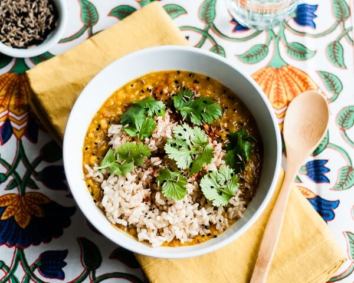

---
date:
  created: 2026-10-11
tags:
  - red lentils
  - dal
  - slow-cooker
  - indian
  - vegetarian
  - vegan
time:
  prep: 10 minutes
  cook: 5 hours on high or 8-10 hours on low
---

# Slow Cooker Red Lentil Dal
A hearty, comforting dal made with red lentils, split peas and warm toasted spices. Serve it with brown rice for an easy, filling meal.
<!-- more -->

## Ingredients
- 600g dried red lentils (or use some yellow split peas or split mung beans, or a combination; 600g total)
- 1.5 L stock
- 800g can diced tomatoes
- 1 large onion, diced, plus extra to serve (optional)
- 4 garlic cloves, minced
- 2 tbsp freshly grated ginger
- 1 tbsp ground turmeric
- 3 green cardamom pods
- 1 bay leaf
- 2 tsp each cumin seeds, mustard seeds, nigella seeds and fenugreek seeds
- 1 tsp fennel seeds
- 1 tsp sea salt
- ¼ tsp freshly ground black pepper
- Chopped coriander, extra cumin seeds and lemon juice, to serve (optional)

## Method
1. Place the lentils in a large bowl, cover with water and leave to soak for a few minutes. Swish to rinse, then drain and rinse again. Transfer to a slow cooker and add the measured stock, tomatoes, onion, garlic, ginger, turmeric, cardamom, bay leaf, salt and pepper.
2. Heat a small frying pan over medium heat. Add the cumin, mustard, nigella, fenugreek and fennel seeds. Toast, shaking the pan or stirring, until fragrant; take care not to toast them for too long or they may become bitter.
3. Add the toasted seeds to the slow cooker and stir well. Cover and cook on high for 4-5 hours or on low for 8-10 hours.
4. Stir the dal and check that the lentils are soft. If needed, cover and cook for another 30-60 minutes. Taste and adjust the seasoning.
5. Serve with coriander, extra onion, cumin seeds and a squeeze of lemon, if desired.

??? info

    This is delightful when topped with [Sambal Sardines](sambal_sardines.md)