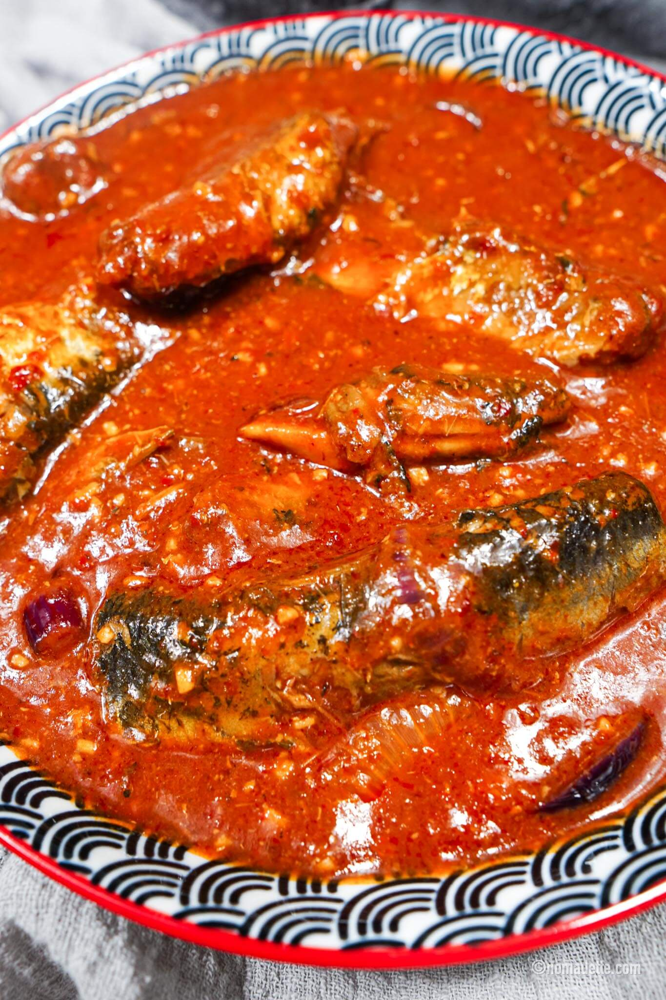

---
date:
  created: 2026-10-11
tags:
  - sardines
  - sambal
  - chilli
  - malaysian
  - seafood
time:
  prep: 5 minutes
  cook: 10 minutes
---

# Sambal Sardines
A quick, spicy Malay dish of sardines simmered in a rich sambal sauce.
<!-- more -->

## Ingredients
- 425g can sardines in tomato sauce
- 50g (about 2 tbsp) dried chilli paste
- Oil, for frying
- 1 onion, sliced
- 2 tsp minced garlic
- 2 tsp minced ginger
- 1 tsp belachan (fermented dried shrimp paste), optional
- ½ cup water
- ½ tsp tamarind paste, optional
- ½ tsp salt, or to taste
- 2 tsp sugar, or to taste

## Method
1. Heat a little oil in a pan over low to medium heat. Add the chilli paste, onion, garlic, ginger and belachan. Sauté until fragrant. For a smoother, thicker sauce, blend these ingredients into a paste before cooking.
2. Continue cooking the chilli paste over low to medium heat, stirring, until it darkens slightly and the oil separates.
3. Stir in the water, tamarind paste, salt and sugar. Bring the sauce to a boil.
4. Add the sardines along with the tomato sauce from the can. Gently stir to coat and simmer for about 5 minutes, just to heat through. Taste and adjust the seasoning.

??? info

    The process in step #2 is known as "[pecah minyak](https://nomadette.com/how-to-cook-dried-chilli-paste/)" in Malaysian cooking.