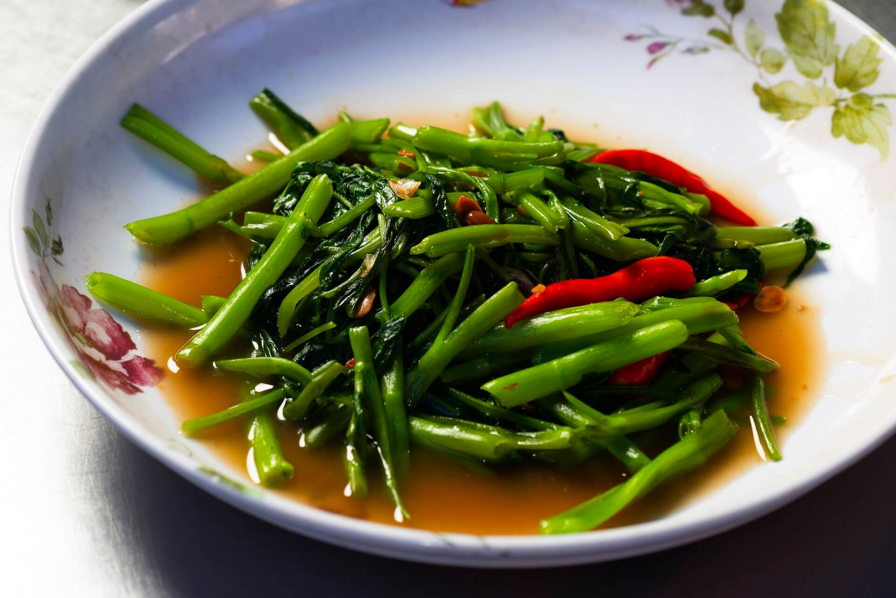

---
date:
  created: 2026-10-11
tags:
  - morning glory
  - water spinach
  - stir-fry
  - thai
  - asian
time:
  prep: 5 minutes
  cook: 2 minutes
---

# Stir-Fried Morning Glory
A vibrant Thai stir-fry of tender morning glory, garlic and chilli. It cooks in under two minutes.
<!-- more -->

## Ingredients
- 1 bunch morning glory (water spinach)
- At least 4 garlic cloves
- 3 or more chillies
- 2 tbsp oyster sauce
- 1 tbsp fish sauce
- 1 tbsp fermented soybean paste
- 1 tsp sugar
- 1 tbsp vegetable oil
- ¼ cup pork or vegetable stock

## Method
1. Rinse the morning glory briefly under cold water and cut into 10–15 cm lengths.
2. Pound the garlic and chillies together in a pestle and mortar until crushed but still fairly chunky.
3. Heat the oil in a wok over high heat until very hot. Add the garlic and chillies and stir-fry for 15–20 seconds.
4. Add the morning glory, oyster sauce, fish sauce, soybean paste and sugar. Stir-fry for about 40 seconds.
5. Pour in the stock and cook for another 10 seconds. Remove from the heat and serve.

??? info

    Pad Pak Boong Fai Daeng in Thai